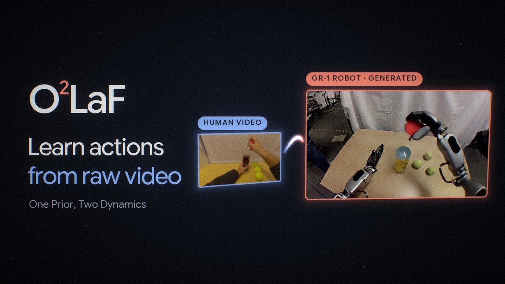

# O²LaF: One Prior, Two Dynamics

[Yuxin Jiang](https://yuxinn-j.github.io/),
[Wenqiang Sun](https://github.com/wenqsun),
[Jiaqi Li](https://lijia7.github.io/),
[Yuchao Gu](https://ycgu.site/),
[Lvmin Zhang](https://lvminzhang.com/),
[Ivor W. Tsang](https://www.a-star.edu.sg/cfar/about-cfar/management/prof-ivor-tsang), and
[Mike Zheng Shou](https://cde.nus.edu.sg/ece/staff/shou-zheng-mike/)

[](https://arxiv.org/abs/2611.26617)
[](https://huggingface.co/papers/2611.26617)
[](https://showlab.github.io/o2laf/)
[](https://github.com/showlab/o2laf)
[](https://huggingface.co/YuxinJ/O2LaF)
[](https://youtu.be/AYWevG1Nhpc)
[](https://x.com/JYuxinn/status/2124783056057999537)

<p align="left">
  <a href="https://youtu.be/AYWevG1Nhpc">
    
  </a>
</p>

## 📖 Overview

Official code for **One Prior, Two Dynamics: Repurposing Video Diffusion
Transformers for Self-Supervised Latent Action Learning**. O²LaF learns latent
actions from unlabelled video, using one pretrained video DiT (Wan 2.2 TI2V-5B)
as the prior for both dynamics:

- **Latent action encoder**: inverse dynamics that maps video transitions to
  32-D latent actions.
- **Causal world model**: forward dynamics trained jointly with the latent
  action encoder.
- **Bidirectional world model** (optional): fine-tuned with the frozen latent
  action encoder.

## 📌 TODO

- [x] [19/11] Paper and project page
- [x] [23/11] Training and inference code
- [x] [23/11] Model weights trained on MiraData and EgoDexMix
- [x] [25/11] Additional latent action encoders: V-JEPA 2 and ST-Transformer
- [ ] Probing and evaluation tools

## 🛠️ Setup Environment

```bash
conda create -n o2laf python=3.12 && conda activate o2laf
git clone https://github.com/showlab/o2laf.git && cd o2laf
pip install torch==2.8.0 torchvision==0.23.0 --index-url https://download.pytorch.org/whl/cu128
pip install -e .
```

## 🗂️ Model Zoo

Every model is one latent action encoder plus two world models. Pass the folder
as the model name, e.g. `--model YuxinJ/O2LaF/o2laf_dit_mixed`.

| Model | Training data | Latent action encoder | Bidirectional world model from |
|---|---|---|---|
| [`o2laf_dit_mixed`](https://huggingface.co/YuxinJ/O2LaF/tree/main/o2laf_dit_mixed) | MiraData + EgoDexMix | Wan DiT | the causal world model |
| [`o2laf_dit_mira`](https://huggingface.co/YuxinJ/O2LaF/tree/main/o2laf_dit_mira) | MiraData | Wan DiT | Wan 2.2 |
| [`o2laf_dit_mira_e2e`](https://huggingface.co/YuxinJ/O2LaF/tree/main/o2laf_dit_mira_e2e) | MiraData | Wan DiT | the causal world model |
| [`o2laf_dit_egodexmix`](https://huggingface.co/YuxinJ/O2LaF/tree/main/o2laf_dit_egodexmix) | EgoDexMix | Wan DiT | the causal world model |
| [`o2laf_vjepa2_mira`](https://huggingface.co/YuxinJ/O2LaF/tree/main/o2laf_vjepa2_mira) | MiraData | V-JEPA 2 † | Wan 2.2 |
| [`o2laf_st_transformer_mira`](https://huggingface.co/YuxinJ/O2LaF/tree/main/o2laf_st_transformer_mira) | MiraData | spatio-temporal transformer | Wan 2.2 |

`o2laf_dit_mixed` is the model the paper evaluates, and the only one that ships
the atomic action library. The last column is where stage 2 started from; see
[Training](#️-training).

† The V-JEPA 2 latent action encoder keeps its trunk frozen, so that trunk is
not part of the release. Download
[`vitg-384.pt`](https://dl.fbaipublicfiles.com/vjepa2/vitg-384.pt) and pass
`--base-action-encoder /path/to/vitg-384.pt`.

## 🎮 Run Demo

Weights download on first use. To use local copies, download them with
`hf download YuxinJ/O2LaF --include "o2laf_dit_mixed/*" --local-dir <o2laf_dir>`
and `hf download Wan-AI/Wan2.2-TI2V-5B-Diffusers --local-dir <wan_dir>` (the
base model), then pass `--model <o2laf_dir>/o2laf_dit_mixed --base-model <wan_dir>`.

#### ▶️ Transfer the actions of a video

```bash
o2laf-transfer --model YuxinJ/O2LaF/o2laf_dit_mixed \
    --source-video assets/examples/gta5.mp4 --first-frame assets/examples/wild_west.jpg \
    --output results/transfer.mp4
```

Options: `--mode bidirectional|causal` (world model), `--cfg-scale` (action
guidance, default 3), `--control transfer|self|zero|shuffle`.

#### 🕹️ Drive a frame with an atomic action

```bash
o2laf-generate --model YuxinJ/O2LaF/o2laf_dit_mixed --list    # idle, w, s, a, d, camera_up/down/left/right
o2laf-generate --model YuxinJ/O2LaF/o2laf_dit_mixed --action w \
    --first-frame assets/examples/wild_west.jpg --output results/w.mp4
```

#### 🐍 Python API

```python
from pathlib import Path

from o2laf import ActionGuidance, LatentActionPipeline
from o2laf.inference.cli.common import load_first_frame, load_source_video

pipe = LatentActionPipeline.from_pretrained("YuxinJ/O2LaF/o2laf_dit_mixed", mode="bidirectional")
actions = pipe.encode_source_actions(load_source_video(Path("assets/examples/gta5.mp4"), pipe.fps))
first_frame = load_first_frame(Path("assets/examples/wild_west.jpg"), pipe.fps)
video = pipe.generate(actions=actions, first_frame=first_frame, guidance=ActionGuidance(scale=3.0))
```

## 🏋️ Training

| Stage | Config | Clips |
|---|---|---|
| 1. Latent action model | `configs/latent_action/{wan_dit,vjepa2,st_transformer}_mira.yaml` | 41 frames |
| 2. Bidirectional world model | `configs/world_model/{wan_dit,vjepa2,st_transformer}_mira.yaml` | 81 frames |

Training data is WebDataset tar shards (one `.mp4` per sample) listed in a
metadata file; no captions are needed:

```json
{"wids_version": 1, "shardlist": [{"url": "/data/miradata/shard-00000.tar", "nsamples": 50}]}
```

```bash
# Stage 1 (global batch 256; here 2 nodes x 8 GPUs)
torchrun --nnodes=2 --nproc_per_node=8 --node_rank=$NODE_RANK \
    --master_addr=$MASTER_ADDR --master_port=$MASTER_PORT -m o2laf.train \
    config_path=configs/latent_action/wan_dit_mira.yaml \
    models.transformer_cfg.model_name=$WAN_MODEL models.idm_cfg.model_name=$WAN_MODEL \
    datasets.train.meta_path=$META

# Stage 2 on the frozen stage 1 latent action encoder (global batch 128)
STAGE1=experiments/latent_action_wan_dit_mira/visualization/latent_action_eval/iter_10000/latent_action_state.pt

# (a) bidirectional world model initialised from Wan 2.2
torchrun --nproc_per_node=8 -m o2laf.train \
    config_path=configs/world_model/wan_dit_mira.yaml \
    models.transformer_cfg.model_name=$WAN_MODEL models.idm_cfg.model_name=$WAN_MODEL \
    datasets.train.meta_path=$META \
    models.fixed_idm_cfg.state_path=$STAGE1

# (b) bidirectional world model initialised from the stage 1 causal world model
torchrun --nproc_per_node=8 -m o2laf.train \
    config_path=configs/world_model/wan_dit_mira.yaml \
    models.transformer_cfg.model_name=$WAN_MODEL models.idm_cfg.model_name=$WAN_MODEL \
    datasets.train.meta_path=$META \
    models.fixed_idm_cfg.state_path=$STAGE1 \
    models.fixed_idm_cfg.fdm_init=merged_e2e_decoder
```

`$WAN_MODEL` is a local copy of `Wan-AI/Wan2.2-TI2V-5B-Diffusers`; `$META` is the
metadata file. Runs write to `experiments/<run_name>/` and resume when
relaunched.

- **Stage 2 initialisation.** (b) merges the causal world model's LoRA into the
  Wan weights and keeps its action embedder; the released model was trained
  this way.
- **From the released model.** `state_path` and
  `models.action_cfg.latent_action_state_path` also accept a released model
  directory, so you can train a world model on the released latent action
  encoder or continue stage 1.
- **Publishing.** `o2laf-export` writes your two stages in the Hugging Face layout.

## 🧩 Adding a Latent Action Encoder

A new latent action encoder is one file and one registration; the trainers need
no change:

```python
from o2laf.action_encoders.base import ActionEncoderSpec, register_action_encoder_spec


@register_action_encoder_spec('my_encoder')
class MyEncoderSpec(ActionEncoderSpec):
    codes_per_transition = 2        # codes emitted per latent transition
    action_ratio_cfg_key = 'my_encoder_action_compression_ratio'
    reads_pixels = True             # False: it reads the VAE latents the caller already holds
    window_rgb_frames = 41          # RGB frames per pass over a longer clip; None for the whole clip

    def build_contract(self, trainer, idm_cfg):
        """What identifies the action space this encoder defines."""
        return {'version': 1, 'architecture': 'my_encoder',
                'action_compression_ratio': trainer.action_compression_ratio}

    def build_encoder(self, trainer, idm_cfg, dtype):
        """Construct, select trainable parameters, and FSDP-wrap."""
        ...
        trainer.set_params_to_optimize(encoder, idm_cfg['param_names_to_optimize'], ())
        return fsdp2_wrap(encoder, transformer_block_clsname='MyBlock')

    def encode(self, encoder, *, latents=None, pixel_values=None, prompt_embeds=None):
        """Take whichever form of the clip this encoder reads."""
        return encoder(pixel_values=pixel_values)
```

Select it with `models.idm_cfg.backend: my_encoder`.

## 📜 License

O²LaF is released under the **MIT License**; see [LICENSE](LICENSE).

## 📬 Contact & Discussion

Feel free to open an issue, or email [Yuxin Jiang](mailto:yuxin.jiang@u.nus.edu),
with questions about the codebase.

## ⭐ Acknowledgement

This codebase is built on [AnyFlow](https://github.com/NVlabs/AnyFlow) and
[Diffusers](https://github.com/huggingface/diffusers), and the models on
[Wan 2.2](https://github.com/Wan-Video/Wan2.2). The alternative latent action
encoders use code from [V-JEPA 2](https://github.com/facebookresearch/vjepa2) and
[Olaf-World](https://showlab.github.io/Olaf-World/). We thank the authors
for open-sourcing their work.

## 📚 Citation

If you find O²LaF useful in your research, please cite:

```bibtex
@article{jiang2026o2laf,
  title   = {One Prior, Two Dynamics: Repurposing Video Diffusion Transformers for Self-Supervised Latent Action Learning},
  author  = {Jiang, Yuxin and Sun, Wenqiang and Li, Jiaqi and Gu, Yuchao and Zhang, Lvmin and Tsang, Ivor and Shou, Mike Zheng},
  journal = {arXiv preprint arXiv:2611.26617},
  year    = {2026}
}
```
